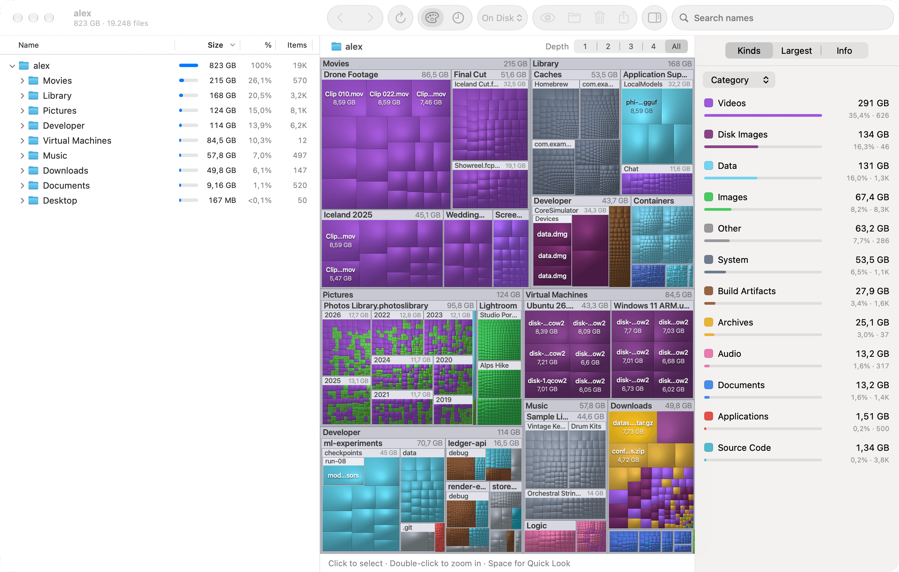
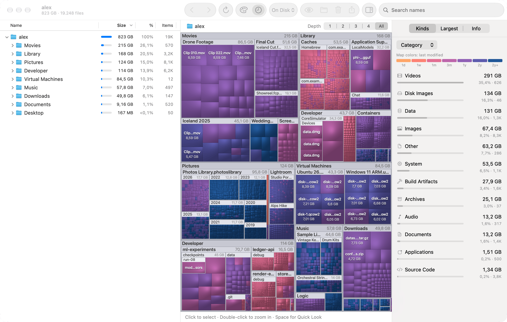
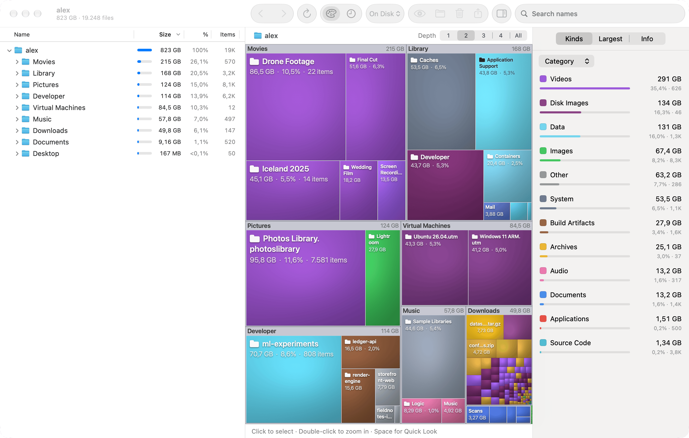
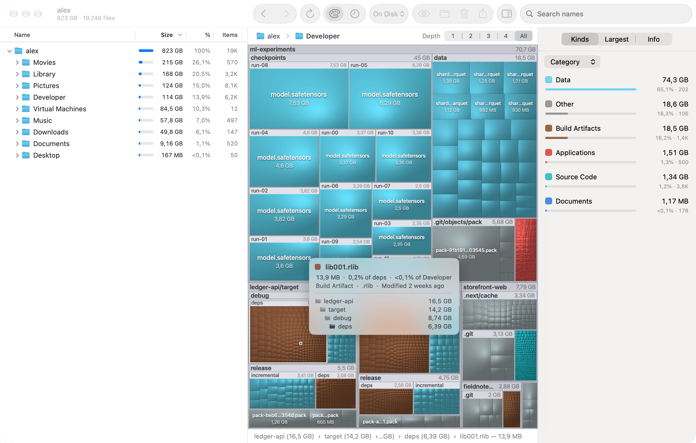
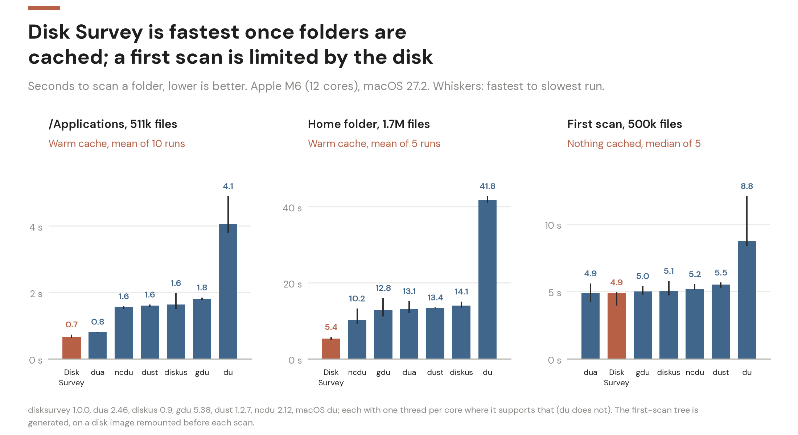

# Disk Survey


Disk Survey is a native macOS app that shows where your disk space went. It scans a folder or a
whole volume and draws it as a cushion treemap — every file is a tile whose area is its size —
next to a sortable outline, so the big things are obvious at a glance and one click away.

<picture>
  <source media="(prefers-color-scheme: dark)" srcset="docs/images/overview-dark.png">
  
</picture>

It is written in Swift for macOS 26 and later, has no third-party dependencies, builds with only
the Command Line Tools, and ships as a universal (Apple silicon + Intel) app with a headless
command line tool using the same engine.

## Install

Download `DiskSurvey-<version>.dmg` from the
[Releases page](https://github.com/dwahdany/disk-survey/releases), open it and drag Disk Survey
to Applications. The app is signed with a Developer ID and notarized by Apple, so it opens
without a Gatekeeper warning. It needs macOS 26 or later, on Apple silicon or Intel.

To build it yourself you need only the Command Line Tools:

```sh
git clone https://github.com/dwahdany/disk-survey && cd disk-survey
Scripts/build-app.sh --install          # universal build, copied to /Applications
```

[DEVELOPMENT.md](DEVELOPMENT.md) covers the build options, tests, the screenshot harness,
benchmarks, signing and releasing, and the architecture.

## Features

- **Fast scanning.** A parallel scanner built on `getattrlistbulk` reads directory entries and
  their sizes in bulk, on all cores, into a compact struct-of-arrays tree. The UI stays responsive
  and the treemap fills in progressively while the scan runs.
- **Cushion treemap.** Squarified layout with cushion shading, animated zoom into folders,
  breadcrumb navigation and hover tooltips. Colour by file kind or by age (below: warm colours are
  recent, blue is years old).

  

- **Folders you can read.** Every folder large enough to carry it gets a frame with its name and
  size, however deep it lies: frames inside frames get slimmer title strips and a lighter tint,
  small folders get none, and a folder that fills its parent shares the parent's title
  (`Music/Albums/Live`), so the big folders inside big folders are named right on the
  map. The **Depth** control above the map (⌘− / ⌘+, ⌥⌘0 for all levels) limits how many folder
  levels are shown below the current folder: at 1 the map is just that folder's children as
  labelled blocks with size, share and item count, coloured by what mostly fills them;
  double-click a block or a folder's title to go straight into it. Pointing at a tile outlines
  its folder and the folders around it, and the tooltip and status bar list that chain with
  each folder's size. Settings › Appearance chooses adaptive frames, frames for the top two
  levels only, or none.

  

  

- **Outline and lists.** Size bars, percentages, item counts and modification dates, with selection
  kept in sync with the map in both directions; a kinds legend (by category or extension, with
  extensionless executables as "Unix Executable"); a "largest files" list; search and filtering.
- **Actions.** Reveal in Finder, Quick Look, Open, Copy Path, and Move to Trash (confirmed first;
  the tree and map update in place, the freed space is reported, and "Put Back" undoes it).
  Disk Survey only trashes what it scanned: the scanned location itself, volumes, mount points and
  folders that contain one are refused; a file whose type or length changed, and a folder whose
  contents no longer match the scan (including folders of a stopped scan and folders holding
  excluded items), are left alone until you rescan. Put Back only restores the item Disk Survey
  itself moved to the Trash. Rescan a folder or everything at any time.
- **Friendly start.** Volumes with capacity bars, common folders, recent scans, drag and drop of
  any folder (also onto the Dock icon), and guidance for granting Full Disk Access.
- **Careful accounting.** Allocated size first, logical size second; hard links counted once;
  firmlinks, mount points and cloud-only files handled without double counting or downloads.
  See [Accounting notes](#accounting-notes) for what the numbers do and do not mean.
- **At home on current macOS.** Standard toolbar, inspector and Settings (which pick up Liquid
  Glass from the system), light and dark appearance, a full menu bar with keyboard shortcuts,
  VoiceOver labels, Reduce Motion respected.

## Full Disk Access

macOS protects parts of your home folder and of the system (Mail, Messages, Safari data, other
apps' containers, Time Machine backups, …). Without permission Disk Survey cannot read those
folders: they are marked as inaccessible and their contents are missing from the totals, so a
scan of your whole disk will add up to less than the space actually in use.

To see everything, add Disk Survey under **System Settings → Privacy & Security → Full Disk
Access** and start the scan again. For Desktop, Documents, Downloads, removable and network
volumes, macOS asks the first time a scan reaches them. Disk Survey only reads names, sizes and
dates — never file contents — and makes no network connections.

The command line tool inherits the permissions of the terminal application it runs in, so grant
Full Disk Access to your terminal if you want complete results there.

## Command line

The same scanner is available without the GUI. The tool lives inside the app bundle at
`Disk Survey.app/Contents/Helpers/disksurvey`; put it on your `PATH` with:

```sh
Scripts/install-cli.sh              # symlinks into /usr/local/bin, or ~/.local/bin
Scripts/install-cli.sh --uninstall
```

```
disksurvey [scan] [path]             Tree of the largest folders and files (default command)
disksurvey top [path]                Largest individual files
disksurvey kinds [path]              Usage by category and file extension
disksurvey find <path> [query]       Search by name, size, kind and age
disksurvey volumes                   Mounted volumes with capacity bars
disksurvey export [path] -f FORMAT   Write the complete tree as json, csv or ncdu
disksurvey help | --help | --version
```

Every command except `export` takes `--json`; `disksurvey --help` is the authoritative reference
for options, the JSON schema and exit codes. `-n 0` lists everything in every command, and
`export -o FILE` replaces FILE only with a complete export (a failed or interrupted scan leaves
an existing file as it was). `--exclude PATH` leaves out exactly that entry — naming a symlink
excludes the link, not what it points to. A path that cannot be read at all is an error (exit
status 1); unreadable folders further down are counted as issues and listed by `--issues`.
When the system held a scan up (see [Performance](#performance)), a line on stderr and the
JSON fields `slowestOpenSeconds`, `slowOpens` and `slowestOpenPath` say so. Real output
(numbers follow your locale):

```
$ disksurvey /Library/Developer/CommandLineTools -d 1 -n 4
/Library/Developer/CommandLineTools  1,42 GB
668 MB  ███████▌          47,2%  ├─ SDKs/
641 MB  ███████▎          45,3%  ├─ usr/
106 MB  █▎                 7,5%  └─ Library/

86.485 files · 21.675 folders · 1,42 GB on disk (3,67 GB logical) · 0,28 s, 387K entries/s

$ disksurvey top /Library/Developer/CommandLineTools -n 3
Largest files in /Library/Developer/CommandLineTools  1,42 GB
70,7 MB  ▊                  5,0%  2 weeks ago  Library/PrivateFrameworks/LLDB.framework/Versions/A/LLDB
69,6 MB  ▊                  4,9%  2 weeks ago  usr/bin/swift-frontend
68,8 MB  ▊                  4,9%  2 weeks ago  usr/lib/sourcekitdInProc.framework/Versions/A/sourcekitdInProc

$ disksurvey find ~/Library --min-size 1G --older-than 6m --json
$ disksurvey export ~ -f ncdu -o home.json        # readable by ncdu -f home.json
```

## Performance



Measured on an Apple M6 (12 cores), macOS 27.2.

| What                                                        | Result                                   |
|-------------------------------------------------------------|------------------------------------------|
| Whole startup disk, `disksurvey /` (4.29 M files, 1.11 M folders, 613 GB) | 12.5 s, 473 MB peak memory |
| Whole startup disk in the app, to the finished map          | 13–14 s, 0.86–0.89 GB peak memory        |
| Treemap layout + cushion rendering, 2,000,000 nodes at 3000×2000 px | about 10 ms                      |
| Worst main-thread stall for any operation on 5.4 M items    | under 100 ms                             |

Totals were compared with `du -sk` on four folders and were identical to the byte in each.
The method, the full tables and the caveats are in
[DEVELOPMENT.md](DEVELOPMENT.md#performance-measurements).

## Accounting notes

Disk usage on APFS is not a single well-defined number. What Disk Survey reports, and where it can
differ from Finder or `df`:

- **Allocated vs logical size.** The primary figure is the *allocated* (physical) size: the
  blocks a file occupies on disk. The *logical* size — the file's length in bytes — is shown as
  a secondary figure. Sparse and transparently compressed files occupy less than their length;
  small files occupy more because of block rounding.
- **Hard links.** A file with several hard links is counted once, at the first link the scan
  encounters; the other links are shown but contribute no size. Which folder "owns" the bytes is
  therefore somewhat arbitrary, but totals are not inflated. The tree remembers which names
  belong to one file, so this stays true afterwards: rescanning one folder does not count the
  file a second time, and when the name that carried the size is trashed, another name takes
  the size over.
- **APFS clones.** Copies made by cloning (Finder's Duplicate, `cp -c`) share blocks until one
  of them is modified. macOS exposes no inexpensive way to discover which files share blocks, so
  each clone is counted at its full allocated size. Folders full of clones therefore look larger
  than the space they really consume, and deleting one clone may free little or nothing.
- **Snapshots.** Local snapshots (Time Machine, system updates) keep blocks of deleted or changed
  files alive. That space belongs to no file in the live filesystem, so it does not appear in the
  treemap, and trashing a file that is still referenced by a snapshot does not free its space
  until the snapshot expires.
- **Purgeable space.** Finder counts space that macOS can reclaim on demand as "available".
  Disk Survey shows what is allocated right now, so its totals can be higher than Finder suggests.
- **Cloud-only (dataless) files.** iCloud Drive and other File Provider items that are not
  downloaded occupy almost no local space and are reported that way. Scanning does not
  download them.
- **Firmlinks and mount points.** The system and data volumes are stitched together with
  firmlinks; Disk Survey follows each path once, so nothing is counted twice. A scan of `/` also
  includes the other local APFS volumes of the startup disk's container that are mounted
  outside `/Volumes` (VM, Preboot, Update, and for example a `/nix` volume), marked as mount
  points. Everything under `/Volumes`, other disks and network shares are not entered unless
  you turn on "Scan into other volumes" (`--cross-mounts`); scan those separately.
- **A whole-disk total is not "used space".** Because of clones, snapshots and purgeable space
  the sum of all files can be higher or lower than what the volume reports as used. The Info
  tab shows both figures side by side when a whole volume was scanned.
- **Inaccessible folders.** Anything Disk Survey is not allowed to read is flagged rather than
  silently treated as empty — see [Full Disk Access](#full-disk-access).
- **Freed space after Move to Trash.** The amount reported is by how much the scanned total
  shrank: the allocated size of what was moved, not counting files that still have another
  hard link in the scanned tree. (The confirmation sheet's "frees about" is the plain sum.) The space becomes available only once the Trash is emptied, and only to the extent that
  clones and snapshots do not still reference the blocks.

## Known limitations

- The interface is English only; numbers and byte units follow the system locale.
- APFS clones are counted once per copy (as `du` and Finder do), so clone-heavy folders look
  larger than the space they occupy.
- Memory use at the peak of a scan is about 90–105 bytes per scanned item on the command line
  (473 MB for a 5.4-million-item startup disk) and about 160 in the app (0.86–0.89 GB for the
  same disk), because the app keeps a partial tree on screen while the final one is built. For
  the same reason the map stops refreshing during a scan once two million items have been read.
- On macOS 27.2, opening a folder in another app's container sometimes blocks in the system
  for 5 seconds. Disk Survey interrupts such an `open` after 0.25 s and retries it, so a scan
  loses a fraction of a second instead; see
  [Performance measurements](DEVELOPMENT.md#disk-survey-by-itself).
- Items whose names are not valid UTF-8 (possible on NFS and some foreign volumes) are shown
  and counted, and can be opened, revealed and previewed, but cannot be moved to the Trash,
  rescanned on their own or have their path copied. A scan *root* with such a name is not
  supported.
- Search ignores case but not diacritics ("istanbul" does not find "İstanbul.png", "resume"
  does not find "résumé").
- A partial rescan or a "Put Back" rescans the affected folder in full, and the tree keeps the
  replaced nodes' memory until the next full rescan.
- With the entry-count shortcut on APFS, an empty folder that is also unreadable is not
  reported as unreadable (sizes are unaffected).
- Modification dates before 1970 are shown as unknown.
- In the smallest window with the inspector open (842 pt) the outline's columns do not all
  fit (it scrolls sideways) and the hint in the status bar is truncated.
- The toolbar is not customizable, and search filters (size, age, kind) are chosen as chips in
  the Search tab rather than typed.
- The treemap's zoom into a folder that is too small to be drawn starts from the tile that
  contains it, not from the folder's exact rectangle.
- Network and non-APFS volumes use a slower `readdir` path that was only exercised through a
  diagnostic switch, not against real network shares.
- The app icon is a single rendered image; there is no layered Liquid Glass icon, because that
  needs Xcode's tooling.
- Builds you make yourself are signed ad hoc and not notarized; the downloads on the Releases
  page are.
- It has only been run on macOS 27.2 on Apple silicon. The Intel half of the universal binary
  and macOS 26 are built for but untested.
- Verification so far is automated (unit tests, the in-app self-test, the screenshot harness,
  scripted trash / undo / rescan runs). Gestures, drag-out to Finder and VoiceOver have not been tried by a person.

## License

MIT — see [LICENSE](LICENSE).
